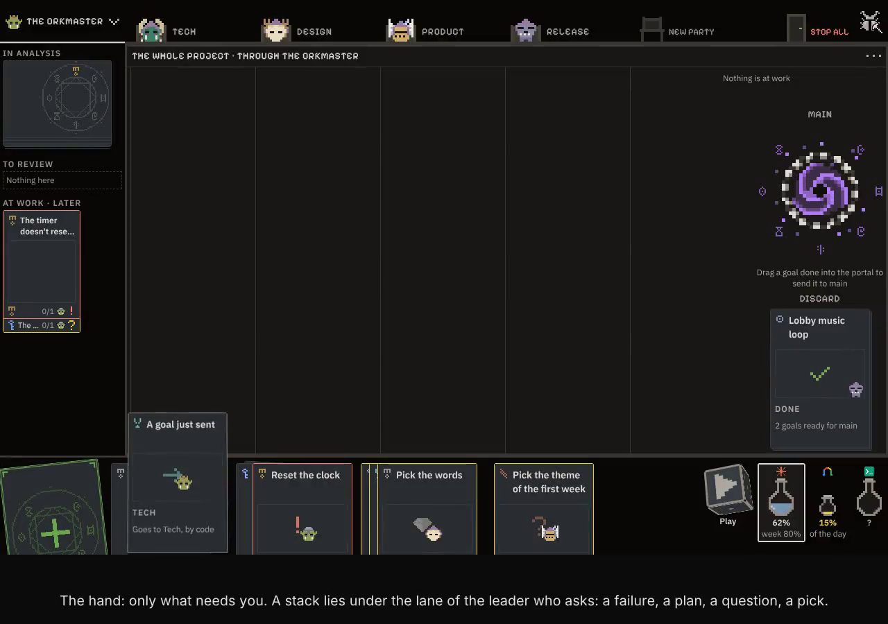

# Orkboard

Orkboard is where you think out your product with a table of leaders — product, design, tech, art, marketing, release —
who judge each goal against your real code and running product, say no where it hurts, and hand what you decide to your
own AI tools to build and check. On the desktop, in VS Code and on a paired phone.

▶ [Watch the tour](docs/media/orkboard-tour.mp4) (about two and a half minutes): the table and its leaders, the Board, a leader's
own map, the hand, a goal from the + card to Done, the mana, the discard, the phone.

## The ideas in one page

**The window is two parts.** *The table* is *what and why, through whose eyes*: a tab a leader, and the pane under the
tabs showing one map. *The hand* lies under the table's lanes and holds *what you decide*, and nothing else. There is no
list column, no drawer, no dialog and no count of what waits: what needs you is a card.

**Who says what.**

- **The Orkmaster** says *what* is done and *who* does it. Its tab is the whole project: its first lane holds the goals
  the Orkmaster is reading, routing and joining, then the goals *in line*.
- **A party's leader** says *how*, what changes and why. It talks a goal over with the other leaders, writes its part of
  the goal's spec, plans its party's work and checks it.
- **A member** does the work, and asks only its leader: a question from a member reaches you only as its leader's card.
- **You** decide: what to make, which way when two leaders disagree, what goes to main.

**A party's craft is its race.** Orks engineer (Tech), elves make the look (Design, Art), goblins run what is live,
gnomes market, knights make the product (Product, a game's Game design), the undead release it. A leader is its race's
higher form (an ork shaman, an elf dryad, a golden unicorn knight, a lich…), and a seat's tier is the gear on its head.
A party's header is its squad: who **Does** (the sword) and who **Checks** (the shield), each seat on the AI tool and
tier you set.

**Every leader has its own map.** The Orkmaster's is the **Board**: a lane a party, a goal a cascade of its tasks, each
task with the head of the ork at work on it. Tech's is the **System**, read from the code with no model: the containers,
their named links, a container's parts in layers, a part's files on its back. Design's is the screens along their flow;
Product's the same with its pains pinned on them; Game design's the loop; Art's the assets; Release's dev against main.
A card pressed is lifted and turns over: its back says what it made and opens its diff, its log or its file over the pane.

**The hand.** A stack lies under the lane of the leader who asks: a failure, a plan, a question, a pick of variants. A
question is a card of two to four choices, one already picked for you with its why. The **+ card** grows into the field:
write a goal, address it to a party with *@Tech* (or by its open tab), paste a picture, point at a part of a map.

**A goal's way: Talk → Spec → Work → Done.**

1. **Routed.** The Orkmaster routes a goal sent and lays the *route card* in the hand: the leaders who will talk it over,
   what it will cost, its place in line. Nothing is called before you press **Talk**.
2. **Talk.** Each leader on the route answers short — a stance, for and against, its questions — and you answer in the
   hand, two rounds at most. Talk closes with the decision, worded by the Orkmaster: **Confirm and start** writes it,
   numbered, into the project's `docs/decisions.md`.
3. **Spec.** Each leader writes its section at once: *Why*, *Done when*, *Checks*, *Will be*, *Out*, *Risks*. What two
   sections disagree on comes to you as a fork, both sides with their why.
4. **Work.** Each party plans its own step; its orks work in their own worktrees, the checks run, the tasks land in dev.
   The hand holds only forks and what falls outside the contract.
5. **Done.** The goal goes to the **discard** on the table, its result promised against made, and waits at the portal
   until you send it **to main**. Nothing reaches main without you.

A bug takes the short way: Tech alone, its Talk is its diagnosis, and one that already reproduces starts straight away.

**The mana.** At the hand's right, your AI tools' limits as potions: what is left of each window, and what a goal will
cost — said in plain words, *about 4% of Claude's week* — before anything spends. When they run low the Orkmaster offers
the short way, or *Later, by itself*: the goal waits in line for the reset.

**▶ Play** runs the project's preview of dev in the pane, to try what the orks made before it goes to main. **Stop all**
is a door: one press stops every ork at work, until work starts again.

**Your tools, your code.** The orks are your own AI tools — Claude Code, Codex, Antigravity and others — each seat on the
tool and tier you choose. Everything lives in your project: the Board in `<project>/.orkcraft/`, the gate's checks in
`orkcraft.toml`, the decisions in `docs/decisions.md`.

The whole window, as decided, is [spec 95](docs/specs/95-the-window-as-decided.md); every decision behind it is in
[docs/decisions.md](docs/decisions.md).

## Install and run

Install it from git: `uv tool install 'orkboard[gui] @ git+https://github.com/orkCraft/orkBoard'` (`[gui]` brings the window
elsewhere than a Mac, where it always comes, and the paired phone's TLS).

Run `orkboard` in a project's folder: it opens in a window of its own (`orkboard --browser` opens it in the browser instead),
and Open folder (Ctrl+O) opens the system's folder dialog. On a Mac, `orkboard --make-app` puts Orkboard.app in
~/Applications, to open Orkboard from the Dock, Launchpad or Spotlight on the last project.

In VS Code, the [Orkboard extension](vscode/README.md) opens the Board of the workspace's folder in an editor tab (it starts
`orkboard --serve`).

On a phone, pair it with the QR code the window shows: the same Board, the hand first.

From the terminal:

| Command | What it does |
| --- | --- |
| `orkboard [folder]` | Opens the project's Board |
| `orkboard measures [folder]` | How the arguing turned out: how often a leader's no was heeded, how often a goal is accepted the first time |
| `orkboard import [folder]` | Reads the project's own documents in (`--dry-run` only says what it would read) |
| `orkboard export [folder]` | Writes the decisions, the brief and the journals out in common formats (`--as madr` or `nygard`) |
| `orkboard update [check]` | Says what is out, and installs it |
| `orkboard usage on\|off\|status` | Anonymous usage stats and crash reports: share them, stop, or see what is set |
| `orkboard drive start\|call\|wait\|run\|shot\|stop` | Drives a project from the terminal by the page's own commands, for an agent testing Orkboard; the AI tools stay hidden unless `--real-tools` |

It is drawn in [orkUI](https://github.com/orkCraft/orkUI)'s office look: dark, monochrome, colour a signal, its only
pictures the races' heads.

It shares Orkline's settings (`~/.config/orkcraft/`) and a project's Board (`<project>/.orkcraft/`, `orkcraft.toml`):
switching between the two loses nothing.

## Licence

Orkboard is open source under the [Apache License 2.0](LICENSE): use it, change it and share it, at work too. The
names (Orkboard, Orkline, orkUI, orkCraft…) and the ork mark are not part of the licence: a fork may say it comes from
Orkboard, and goes by a name and a mark of its own. What Orkboard bundles from others, and under which licence, is in
[NOTICE](NOTICE).
